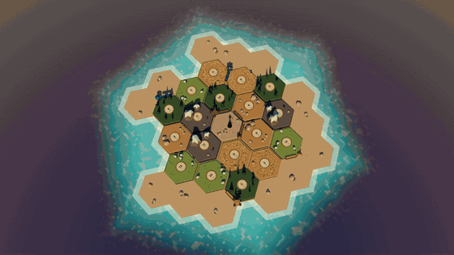

# Kervan Yolu

Arkadaşlarla internet üzerinden oynanan, altıgen haritalı özgün bir kaynak–takas–inşa strateji oyunu.
Web ve mobil (PWA) · 2–6 oyuncu · 3D veya 2D tahta · Türkçe / English · üç değiştirilebilir tema.

<p align="center">
  <a href="docs/media/kervan-yolu.mp4?raw=true">
    
  </a>
  <br>
  <a href="docs/media/kervan-yolu.mp4?raw=true"><b>▶ Tanıtım klibini indir (23 sn, sesli, 9 MB)</b></a>
</p>

## Hızlı başlangıç (geliştirme)
```bash
npm install
npm run dev
```
- Arayüz: http://localhost:5173 (sunucuya `/api` ve `/ws` üzerinden vekil bağlanır)
- Sunucu: http://localhost:3000
- Aynı ağdaki telefondan denemek için: `http://<bilgisayarın-IP>:5173`

## Üretim
```bash
npm run build
npm start
```
Tek port (3000) hem oyunu hem WebSocket'i sunar. Buluta yayın için: [docs/DEPLOY.md](docs/DEPLOY.md).

## Nasıl oynanır
1. Takma adını yaz → **Oda oluştur**. Oda kodunu ya da davet linkini arkadaşlarına gönder.
2. Arkadaşların **Kodla katıl** ile girer. Ev sahibi harita boyutunu (2–4 / 5–6 kişi), hedef puanı ve temayı seçip başlatır.
3. Kurallar: [docs/RULES.md](docs/RULES.md).
4. Ev sahibi oyunu **duraklatabilir**; oyun sunucuda kayıtlıdır. Ana ekrandaki **Oyunlarım** listesinden aynı cihazla kaldığın yerden devam edersin. Bağlantı koparsa otomatik geri bağlanır.

## Proje yapısı
| Klasör | İçerik |
|---|---|
| `packages/shared` | Tipler, protokol, saf oyun motoru + testler |
| `apps/server` | Express + WebSocket + SQLite (`node:sqlite`) |
| `apps/client` | React + three.js (react-three-fiber) + zustand + PWA |
| `docs` | Plan, kurallar, yayın kılavuzu, geliştirme günlüğü |

## Komutlar
| Komut | Ne yapar |
|---|---|
| `npm test` | Tüm testler (motor + sunucu) |
| `npm run typecheck` | TypeScript denetimi |
| `npm run build` | İstemci + sunucu derlemesi |
| `npx tsx scripts/bot.ts KOD [ad] [ws-url]` | Odaya test botu sokar (tek başına denemek için) |

Gereksinim: Node.js 22.13+ (yerleşik SQLite için).
